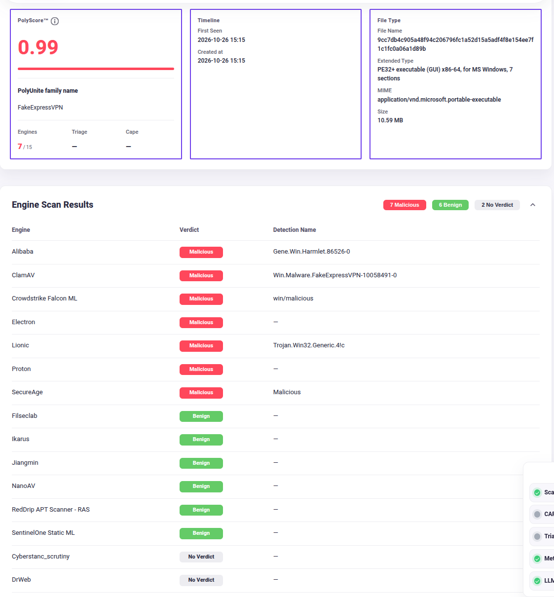
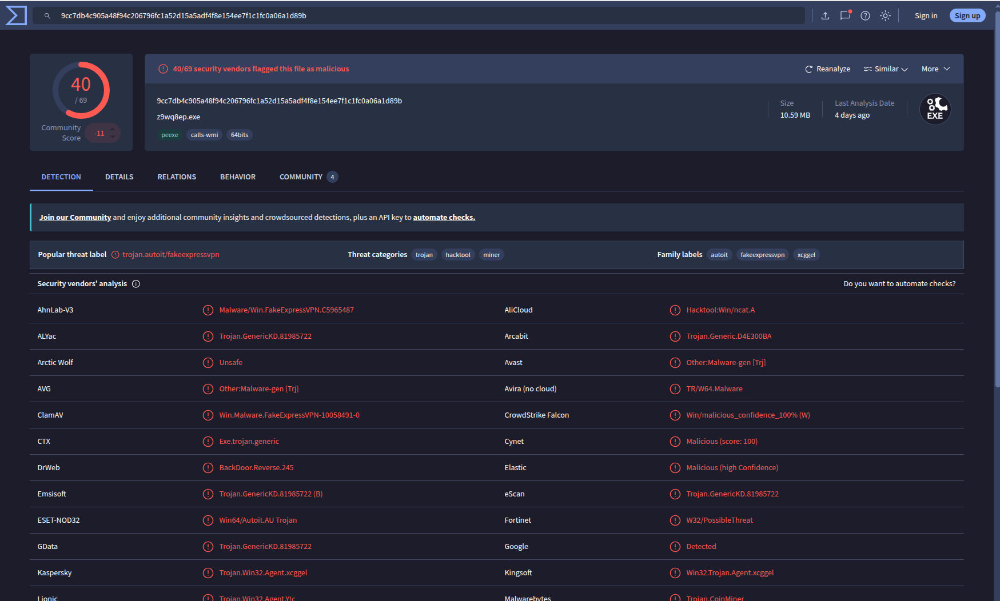

# 0012 — The band edges are halved; consensus malicious starts at half

- **Status:** Accepted
- **Date:** 2026-11-03
- **Affects:** `specs/01-estimand.md` (§9), `specs/99-open-questions.md`, `src/polyscore_v2/config.py`, `src/polyscore_v2/draw.py`, `pipeline/01b_draw.py`, `tests/test_draw.py`

## Context

§9 cut the bands on `m` at 0.2 and 0.8, with consensus malicious at `m = 1.0` — every
answering engine agreeing. [`0006`](./0006-stratified-sampling-with-recorded-inclusion-probabilities.md)
said those edges were chosen before anyone looked and would be revisited once, against a
report. This is that revision.

**The top band is empty by construction.** On this roster a benign verdict is mostly the
absence of a signature: an engine with no coverage for the family, or no PE coverage at
all, answers benign. So `m` has a ceiling set by the roster, not by the file, and
unanimity is not something a malicious file ever earns. The stage data, small as it is,
says exactly that:

- the stage frame — 278 artifacts in the 2024–2026 window, about 15 answering engines
  each — holds **no** artifact at `m = 1`, 22 at `0.8 ≤ m < 1`, and 198 in the old
  contested band;
- in the 32-row labellable base the highest `m` is 13 of 15. The only scans anywhere in
  it that reach `m = 1` are three *label* scans where **three** engines answered, all
  malicious — so the top band, where it fills at all, fills with low coverage, the
  opposite of consensus;
- the composition report's bound: the largest cohort every band can fill at the §9
  shares is **0**.

**The worked example.** A file established by hand to carry a covert miner and a
clipboard hijacker. The portal shows 7 of 15 engines malicious — which is **7 of 13
definite verdicts** once the two `No Verdict` rows are left out of the denominator, as
§9 requires — so `m = 0.54`. VirusTotal shows 40 of 69 vendors. Any analyst files this
under consensus malicious. The old edges filed it under contested, next to files with two
detections out of fifteen.

## Decision

Keep `m` exactly as §9 defines it and **divide the edges by two**:

| Stratum | Was | Now | At 15 answering engines |
|---|---|---|---|
| Consensus clean | `m = 0` | `m = 0` | 0 hits |
| Leaning clean | `0 < m ≤ 0.2` | `0 < m ≤ 0.1` | 1 hit |
| Contested | `0.2 < m < 0.8` | `0.1 < m < 0.4` | 2–5 hits |
| Leaning malicious | `0.8 ≤ m < 1` | `0.4 ≤ m < 0.5` | 6–7 hits |
| Consensus malicious | `m = 1` | **`m ≥ 0.5`** | 8 or more |

The answering floor, unset until now, is **10** — two thirds of the observed median
coverage of 15 — so that a 1-of-2 scan cannot land in consensus malicious. The target
shares are unchanged. The estimand goes to **version 6**; no result exists under any
earlier version, so nothing is invalidated.

**This is a judgement call, and it is recorded as one.** Nothing above measures where
consensus ends and contest begins; it shows only that the old edges put the line
somewhere no file ever reaches. Halving is a *because it seems right* decision. It
encodes the proposer's perception of the state of reality — that on this roster, half of
the definite verdicts is as much agreement as a plainly malicious file ever gets, and
that below one detection in ten the question is genuinely open. It is debatable, and it
is meant to be debated against data: the per-band **T+30 flip rate** on the prod base is
what confirms or moves these edges, and the revision goes in a new record, not in this
one.

## Alternatives considered

| Option | Why not |
|---|---|
| Leave the edges until the prod survey reports | The draw cannot fill its design at any cohort size today. A rehearsal that under-fills three of five bands rehearses the wrong thing. |
| Stratify on the hit count rather than the fraction | Honest about the asymmetry — a malicious verdict is a finding, a benign one the absence of one — and it is baseline 3's own statistic. Deferred: at this roster's coverage (12–18 answering) the count and the halved fraction cut the data in nearly the same places, and the fraction is what the spec and the deck already teach. Revisit if coverage widens or the roster drifts. |
| Edges from quantiles of the realized `m` distribution | The bands would move with the roster and the window, so "contested" would mean something different in every run. |
| Consensus at 0.45 | Would also put 7 of 15 in consensus, at the cost of a leaning band one hit wide. Not needed once the denominator is counted as §9 says. |

## Consequences

- **The bands read as hit counts**, and a boundary moves by one hit as coverage moves:
  the same seven detections are leaning malicious at fifteen answering engines and
  consensus at thirteen. The floor bounds how far that wobble goes; it does not remove it.
- **The contested band is now small**, which is what the 45% over-weighting is for. Its
  absolute size on prod bounds the cohort; under-fill is still reported, never back-filled.
- **Old runs stay interpretable.** Every cohort manifest records the edges it was drawn
  under. The rehearsal runs carry `0.2 / 0.8` and remain rehearsals.
- **Still owed**, now on [`99-open-questions.md`](../specs/99-open-questions.md) as a
  measurement rather than a decision: the per-band flip rate, the realized shares against
  the targets, and the answer-count distribution that sets the floor properly. The 45%
  share is still an assertion.
- The deck's draw slide carries the new edges, and a slide beside it carries the two
  screenshots and this record's reasoning.
